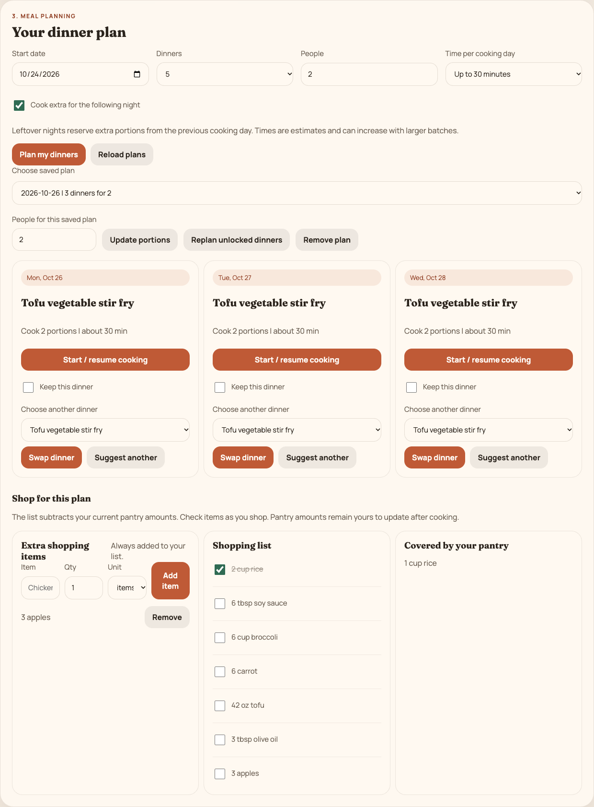
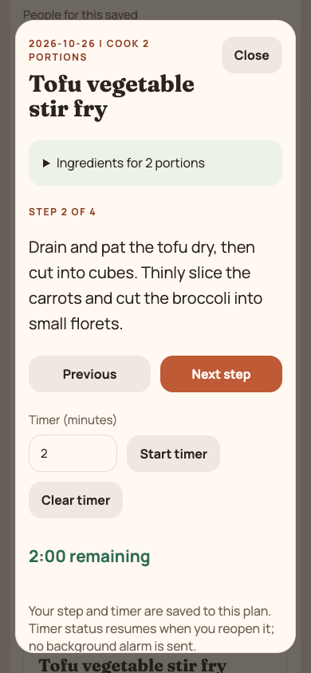

# First cooking week: verification

Verified locally on October 24, 2026. This extends the [October 13 baseline](verification.md); that earlier record describes the prototype before these changes.

## Behavior delivered

A user can plan dated dinners for 1-8 people, reserve the following night for leftovers, lock dinners, change portions, and swap eligible recipes. Shopping totals scale from recipe base servings and subtract measured pantry stock once across the selected plan. Manual purchases remain extra. Grocery checkmarks and cooking steps/timers survive reloads.

Diet settings use AND semantics. A recipe must satisfy every selected diet, recognized exclusion, and cooking-time limit. No unrestricted fallback remains. An unrecognized exclusion is rejected with an explanation. If settings change, conflicting saved dinners are marked and their plan's shopping list is withheld until corrected; guided cooking also rejects conflicting dinners.

The catalog contains 17 recipes, including 12 dinners. Oatmeal is no longer tagged vegan; Caesar dressing is treated as containing fish, egg, and milk. Recipes include structured amounts, base servings, ingredient allergen metadata, and clearer cooking directions. Recipe tags describe the catalog ingredients, not every possible packaged substitute.

## Verification results

- 12 domain tests cover quantity subtraction, US volume conversion, incompatible units, manual purchases, leftovers, diet intersections, unsupported exclusions, invalid input, stale edits, locked meals, and invalidated cooking progress.
- 83 API requests against real MySQL cover registration, password hashing, login, session expiration/logout, unauthenticated access, account isolation, review ownership, cross-origin rejection, input validation, diet failures, plans/swaps, serving changes, shopping checkmarks, and cooking persistence.
- Concurrent requests add 12 pantry quantities while saving a favorite and an extra shopping item. All changes persist.
- Migration checks run twice and verify legacy password hashing, preserved pantry/favorites/plans, corrected catalog data, and archived recipe rows.
- Browser workflows at 1440x1000 and 390x844 cover registration, preferences, pantry amounts, three dinners, swaps, exact rice shortages, extra purchases, checkmarks, cooking progress/timer restoration, locked dinners, and logout. No page errors or horizontal overflow were observed.
- The optional standalone frontend also passed registration, cross-port cookie persistence, reload, and logout.
- Root production dependencies and the standalone frontend have zero reported audit vulnerabilities in the October 24 check. This is a dated dependency check, not a security certification.

The browser checks run in isolated test sessions with disposable accounts. No real grocery lookup, paid API, public deployment, or physical cooking trial was performed.

## Browser views

## Migration

`backend/migrate.js` takes a database advisory lock before applying changes. It adds the sessions table, recipe serving metadata, and migration bookkeeping. The catalog migration archives existing bundled recipe IDs in `recipe_baseline_archive`, then updates those IDs and records the migration in one transaction. Custom recipe rows are retained; recipes without structured amounts and base servings are not eligible for the dinner planner.

Legacy passwords are hashed before requests are accepted. The API does not have a plaintext comparison fallback. Migration does not keep a plaintext password backup. Existing external database backups may still contain old values and remain the operator's responsibility.

Existing preferences, favorites, pantry data, shopping items, meal history, and old plans are retained. Legacy pantry names without amounts are shown as unmeasured and do not subtract from shopping. Old plans remain visible but cannot use new planning calculations until a new dinner plan is created. New updates lock the user row during each transaction and write only the affected fields. Plan version checks reject stale structural edits.

The migration was exercised only on the new disposable local database. The original team checkout and its database configuration were not changed.

## Implementation references

Password storage uses Node's built-in scrypt with a unique salt and N=32768, r=8, p=3, a configuration listed in the [OWASP password storage guidance](https://cheatsheetseries.owasp.org/cheatsheets/Password_Storage_Cheat_Sheet.html). Random session tokens are stored as SHA-256 hashes, expire after seven days, and are revoked on logout. Cookies are HttpOnly and SameSite=Lax, with Secure enabled in production. Unsafe browser requests require the application header and an allowed origin, following the concerns described in [OWASP session guidance](https://cheatsheetseries.owasp.org/cheatsheets/Session_Management_Cheat_Sheet.html).

Recipe temperatures and reheating notes reference the [FoodSafety.gov minimum-temperature chart](https://www.foodsafety.gov/food-safety-charts/safe-minimum-internal-temperatures). Storage reminders reference [FoodSafety.gov's food-handling guidance](https://www.foodsafety.gov/keep-food-safe/4-steps-to-food-safety). These checks do not establish allergy safety, validate nutrition, or replace checking actual food temperatures and storage conditions.

## Follow-up: shopping and cooking records

The next increment closes the workflow after a shopping trip or a dinner. Checked purchases open a review of actual amounts bought; saving adds them to the pantry and removes purchased manual extras. A purchase ID makes retries safe, including concurrent duplicate requests.

Finishing a dinner opens an ingredient-use review. Saving deducts only available tracked stock, records any untracked amount, preserves the original recipe and portions, and excludes that cooking day from future shopping totals. Serving its leftovers does not deduct raw ingredients again. Undo restores only the quantities actually deducted, and dependent leftovers must be undone before their source batch. Pantry edits set the amount remaining and reject stale reviews.

Optional cooking observations record actual minutes, a portion-size judgment, and notes. Empty fields stay unknown. These observations are user-entered and do not automatically change recipe estimates. The automated tests use synthetic observations, not measurements from real cooking.

Follow-up verification: 20 domain tests, the original 83 API checks plus 50 kitchen-cycle API checks, and desktop/390px browser workflows all passed locally. The new checks cover reviewed purchases, concurrent retries, partial inventory, measured use, observations after reload, completed-plan protections, served leftovers, ownership, stale inventory, and undo. Browser checks also verify that notes containing markup remain literal text and that a failed save retains the entered observations.

No new database schema is required for this increment. Records are stored with each user's existing plans and written in the same transaction as pantry changes. Existing plans default to no purchase receipts or finished dinners.

## Next practical validation

Cook several of the dinners, measure prep time and serving yield, and compare the shopping list with actual purchases. Those observations should guide catalog corrections and the next product changes.
