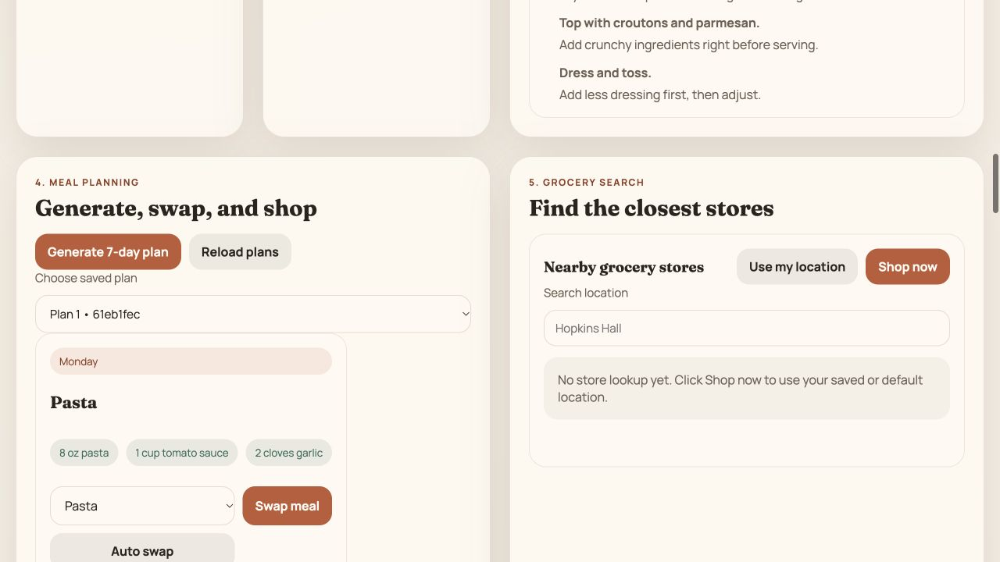

# Verification on October 13, 2026

## Environment

- Node.js 24.19.0 and npm 10.9.9.
- A fresh disposable MySQL 8.4.11 container, bound to local loopback.
- Root and frontend dependencies installed from lockfiles, then updated within existing package ranges using the package manager's audit fix. The API checks passed again after restarting both servers.
- Real Express backend and MySQL persistence, with the supplied seed recipes.

## Passed

- Added `backend/schema.sql`, reconstructed from the actual users/recipes queries, and imported it into an empty database.
- Corrected the review-table foreign-key column collation to match the grocery-store key. Without this correction, fresh table creation has incompatible collations.
- API startup, database connection, empty-database recipe seeding, and health check.
- `node scripts/smoke-local.mjs`: 12 successful requests covering registration, login, saved preferences, pantry, favorites, seven-entry meal planning, manual and automatic swaps, shopping aggregation, and persisted plan retrieval.
- Browser verification: registration, preferences, garlic in the pantry, Pasta as a favorite, meal-plan generation, three manually added apples, a Monday meal swap, and restored data after reload.

The image shows the existing course UI running with a disposable account. It is not a mockup or a production deployment.

## Not yet verified or release-ready

- Google grocery search requires a new user-supplied key. No external lookup was made, and no paid API was enabled.
- Store-review persistence has source and schema inspection but no browser workflow test against a real store result.
- Password storage and user-ID authorization remain prototype implementations.
- Dietary filtering can fall back to unrestricted recipes when no candidates remain. A seed oatmeal recipe is tagged vegan while containing milk and honey. Tags and restriction handling must be audited before relying on dietary behavior.
- Plans contain seven recipe entries, one per displayed day, rather than breakfast, lunch, and dinner for every day.
- Allergy handling, nutrition, cooking safety, concurrency, interrupted writes, and mobile responsiveness require additional testing.
- The root dependency audit initially reported four advisories, including one critical advisory. After compatible updates, it reported zero. The frontend audit still reports one moderate `qs` advisory group through Express 4; automatic fixes did not resolve it. Dependency results are a dated check, not proof of application security.

## Source hygiene

The example configuration no longer contains the Google Maps key. The key also exists in original Git history; a cleaned publication must handle that history, and the key owner should revoke or rotate it. Removing text does not revoke a credential.

Tracked `frontend/node_modules` were removed from the prepared index; dependencies are restored from lockfiles. The original team repository and Saavan's original checkout remain intact.
